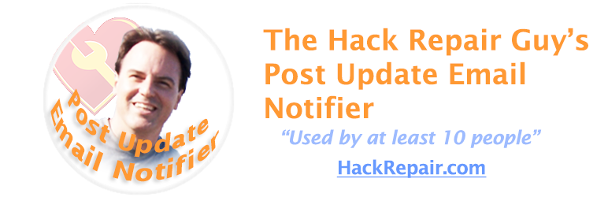

  

<h1 align="center">The Hack Repair Guy's Post Update Email Notifier</h1>

**Keep your team or clients informed when published WordPress content changes, with branded emails sent to the roles you choose.**

Updating a page is easy. Remembering to tell everyone who needs to know is another task. Editors need to know when a reference changes, clients want to review revised pages, and site owners need a useful record of what was announced.

**The Hack Repair Guy's Post Update Email Notifier** sends individual HTML emails to users in selected WordPress roles when you announce an update to published content. Customize the message and branding, include a link to the updated page, and optionally exclude the person making the change.

Notifications are intentional: **Don’t send email notifications** is checked by default. Uncheck it for the update you want to announce. Afterward, the post returns to the site default, helping routine edits stay quiet. Prefer the opposite? Switch the site default so updates send unless an editor opts out.

**[Download the latest release](https://github.com/tvcnet/hackrepair-post-update-email-notifier/releases/latest)** · **[Plugin documentation](readme.txt)** · **[Report an issue](https://github.com/tvcnet/hackrepair-post-update-email-notifier/issues)**

**Release status:** This branch describes the upcoming 1.6.1 candidate. The latest published release is still 1.5.0; the new features below will ship with 1.6.1 after final review.

## Features

| Feature | What you control |
| --- | --- |
| Role-based recipients | Choose which WordPress roles receive notifications and optionally exclude the updating user. |
| Per-update choice | Announce a particular update using the checkbox in the editor, which shows how many people will be emailed. Choose whether editors opt in or opt out, and whether first publishes notify. |
| Calm sending | A per-post cooldown prevents bursts from repeated saves, and larger lists are sent in background WP-Cron batches so saving stays fast. |
| What changed | `[change_summary]` lists title changes, words added or removed and excerpt updates; `[revision_url]` links to the revision comparison. |
| Content selection | Limit notifications to selected public post types. |
| Branded HTML email | Customize the subject, message, header, colors, footer, From and Reply-To settings. The email wrapper fills the available width. |
| Template placeholders | Include the title, public URL, author, editor, site name and update time without rewriting each message. |
| Recognizable subjects | Identify the site and plugin: `[example.com] [Post Update Email Notifier] Post Updated: About Us`. |
| Email previews | Preview the email right in Settings without sending, or send yourself a test. An optional plain-text alternative is also available. |
| Optional email log | Keep 50, 200 or 1,000 entries, inspect failures, skip reasons and background progress, and export a CSV. Included in WordPress personal data export and erasure. |
| Site Health and WP-CLI | Site Health flags repeated failures and sender-domain mismatches; `wp pue` tests, sends, counts recipients and exports the log. |
| Contextual help | Question-mark help beside settings and actions explains what each feature does and how to use it. Hover, focus or tap to read; Escape or click outside to close. |
| Familiar WordPress interface | Settings cards, inline feedback, native View Details and an Other THRG Plugins guide. |
| GitHub updates | Receive standard WordPress update notices for matching published release packages. |

## How it works

1. **Choose your recipients.** Open **Settings → Post Update Notifier** and select the roles to notify. No roles are selected by default.
2. **Prepare your email.** Set the subject, message, branding and email identity, then send yourself a test.
3. **Announce an update.** Edit published content, uncheck **Don’t send email notifications**, and save the update.
4. **Review the result.** Each selected recipient receives an individual message through WordPress mail. If logging is enabled, inspect the recorded sending results.

Autosaves and revisions are skipped. Programmatic inserts never notify. The per-post checkbox returns to the site default after each update, and the log explains any opted-in update that could not be sent.

## Installation

1. Download `hackrepair-post-update-email-notifier.<version>.zip` from the [latest release](https://github.com/tvcnet/hackrepair-post-update-email-notifier/releases/latest).
2. In WordPress, open **Plugins → Add New → Upload Plugin** and select the ZIP.
3. Install and activate **The Hack Repair Guy's Post Update Email Notifier**.
4. Open **Settings → Post Update Notifier**, configure recipients and send a test email.

Requires **WordPress 6.6+** and **PHP 7.4+**. Use the uploaded plugin ZIP from the release assets; it contains the correct installed folder and bundled updater dependencies.

**Upgrading from an older Google Drive-based version?** Upload the release ZIP manually once and confirm the replacement in WordPress. Existing settings are preserved. That update installs the GitHub updater for future releases.

## Updates

The plugin checks this repository's [GitHub releases](https://github.com/tvcnet/hackrepair-post-update-email-notifier/releases). A matching `vX.Y.Z` tag and uploaded `hackrepair-post-update-email-notifier.X.Y.Z.zip` are required before WordPress offers an update. Source-archive fallbacks are rejected.

GitHub may temporarily rate-limit update checks from a shared server IP. An unavailable update check does not stop notification features from working. See the [migration and update plan](docs/plans/1.5.0-standardization.md) for maintenance details.

## Privacy and email delivery

Messages use your site's WordPress mail configuration. The plugin does not store SMTP credentials. Configure your site's mail service and test it before enabling notifications; **acceptance for sending does not confirm delivery**.

Logging is optional. When enabled, recipient addresses, subjects and message context can appear in the log and CSV exports. Choose an appropriate retention limit and handle exports accordingly.

GitHub receives standard connection information during update checks, such as the server IP. Post content and recipient lists are not included in those checks.

## Background delivery and recovery

Progress is saved per recipient. If a process stops during a send, that recipient's outcome is unknown and the plugin does not resend it automatically. This favors avoiding duplicate messages; it cannot guarantee exactly-once delivery.

An independent WP-Cron recovery check runs every 15 minutes. Missing batch callbacks are retried up to five consecutive scheduling failures. Site Health reports paused or failed scheduling even when email logging is off. Operators can inspect `wp pue jobs` and retry only unattempted recipients with `wp pue retry JOB_ID --yes` after checking the cron configuration.

Pending message payloads expire after seven days and are deleted on the next recovery run. Deactivation removes delivery callbacks; pending work can resume on reactivation within that window. Reset and Clear Log do not cancel queued messages. Uninstall removes the jobs and their callbacks. WordPress privacy erasure removes matching addresses from the optional log; it does not cancel queued notifications or erase arbitrary text inside message bodies.

## FAQ

**Will every edit send an email?**

With the shipped skip-by-default policy, no: explicitly uncheck **Don’t send email notifications** for an update you want to announce. With the optional send-by-default policy, eligible updates notify unless an editor opts out. No notification roles are enabled by default.

**Can I notify clients as well as editors?**

Recipients must have WordPress accounts in the roles you select. Choose roles carefully: selecting a role includes its eligible users.

**Will recipients see each other's email addresses?**

The default notification workflow sends a separate message to each recipient.

**Can I keep my existing email templates?**

Yes. The upgrade preserves saved templates and settings. Subjects include the configured domain and plugin name, and the HTML wrapper uses the available width.

**What should I check if mail does not arrive?**

Send a test email, review the optional log, and check your site's SMTP or mail-provider logs and the recipient's spam folder. A successful WordPress sending result is not a delivery receipt.

**Is this designed for large mailing lists?**

Automatic mode queues lists above 20 recipients and sends them in WP-Cron batches. You can also choose background sending for every list, or synchronous sending for small lists. WP-Cron needs site visits or a server cron job; it does not guarantee a precise delivery time. Bulk Test remains synchronous and sends real mail. Evaluate hosting and mail-provider limits before enabling large groups.

## For developers

The plugin provides hooks for placeholders, recipient selection, subjects, headers and final HTML. See [readme.txt](readme.txt) for signatures and examples.

For the source layout, validation evidence and contribution workflow, read [PROJECT.md](PROJECT.md), [MAINTAINING.md](MAINTAINING.md) and [CONTRIBUTING.md](CONTRIBUTING.md). CI covers standalone PHP 7.4/8.3 checks and real WordPress on PHP 8.1/8.3. The integration matrix includes WordPress 6.6 and latest; see the project record for the most recently verified run. Local WordPress integration uses PHP 8.2.33. These checks do not establish external email delivery or large-recipient performance.

## Third-party code

Update checks use [Plugin Update Checker](https://github.com/YahnisElsts/plugin-update-checker) by Jānis Elsts, included in `plugin-update-checker/` under its MIT license.

## Author and support

**[Jim Walker](https://hackrepair.com/)** — The Hack Repair Guy — author and maintainer.

[Questions, ideas and community support](https://github.com/tvcnet/hackrepair-post-update-email-notifier/discussions) · [Report a bug](https://github.com/tvcnet/hackrepair-post-update-email-notifier/issues) · [Security reporting](SECURITY.md) · [Buy Jim a coffee](https://hackrepair.com/donations/buy-jim-a-coffee)

## License

GPLv2. See the [GNU General Public License v2.0](https://www.gnu.org/licenses/old-licenses/gpl-2.0.html) and the repository's [license notice](LICENSE).

## Changelog

See the **Changelog** section of [readme.txt](readme.txt).
